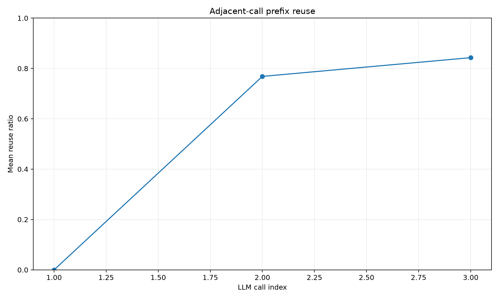
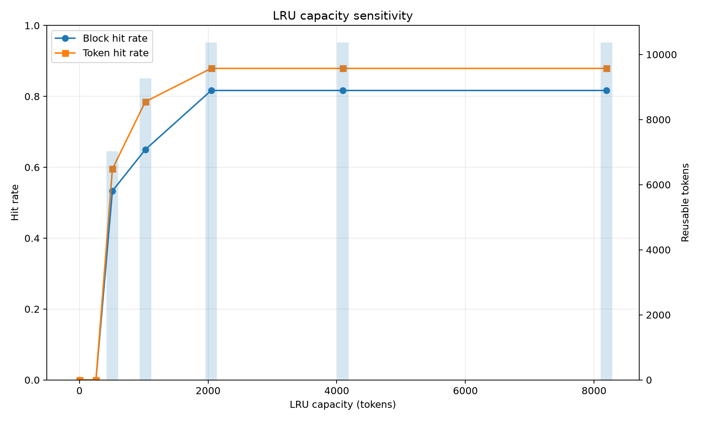

# 面向智能体的Prompt结构与KV Cache复用特征分析

技术报告 · 2026 年 11 月

## 摘要

本研究以 Qwen-Agent 的多轮工具调用为对象，分析模型输入的组成及其前缀复用潜力。实验基于本地 Qwen3-4B，对 4 个同类任务各运行 2 次，采集 24 条模型调用轨迹。其中，同次运行内的相邻请求共有 6,904 个公共前缀 Token，占全部 11,536 个规范化输入 Token 的 59.85%。在允许跨任务保留缓存的 LRU 模拟中，容量为 2,048 Token 时的 Token 命中率为 87.90%。本研究另对 16 组相邻请求开展 64 对本地计时。启用前缀复用后，首 Token 延迟的中位数由 461.0 毫秒降至 91.9 毫秒。

## 1 研究背景

在多轮工具调用中，智能体将系统提示、工具说明和历史消息与新产生的工具结果一并提交给模型。相邻请求因而可能共享顺序一致的输入前缀。若其对应的注意力键值（KV）仍保存在缓存中，推理服务可复用已有计算结果，减少输入处理阶段（Prefill）的重复计算。SGLang 的 RadixAttention 提供了一种跨请求复用 KV Cache 的实现。[SGLang 论文](https://arxiv.org/abs/2312.07104)

本实验分别测量轨迹中的公共前缀长度、给定容量下的模拟命中率，以及本地推理中的首 Token 延迟。三项指标分别用于描述输入特征、缓存容量的影响和特定运行条件下的实际收益。

## 2 实验环境与轨迹采集

轨迹采集使用 Qwen-Agent 0.0.34 和 Ollama 0.40.4，模型为 Qwen3-4B 的 Q4_K_M 量化版本。任务采用统一的两步工具调用流程。第一次模型调用请求单位换算，第二次调用根据换算结果请求计算总量，第三次调用根据工具返回结果生成最终回答。4 道长度计算题各执行 2 次，每次均产生 3 次模型调用。[任务集](data/tasks.jsonl) · [实验配置](configs/local_ollama.json)

在 Qwen-Agent 的 `llm.chat` 接口记录输入消息、工具说明、模型响应、调用顺序及耗时。模型发出的工具请求记录在响应中，工具返回结果记录在后续调用的输入消息中。[调用轨迹](outputs/final_experiment_v2/traces/calls.jsonl) · [任务运行记录](outputs/final_experiment_v2/traces/runs.jsonl)

## 3 实验方法

### 3.1 Prompt 分段与公共前缀统计

模型输入划分为系统提示、工具说明、对话历史、工具结果和当前问题五类。各类别分别序列化，再使用 Qwen-Agent 自带的分词器编码。分段占比以五类 Token 数之和为分母，计数包含序列化标记。计算整条输入的公共前缀时，系统提示和工具说明置于固定位置，其余消息保留原有顺序，整条输入作为一个序列编码。两个统计口径分别用于描述组成和比较前缀。

在同一次运行内，对相邻调用的 Token 序列计算最长公共前缀。单次调用的重复比例为公共前缀长度除以当前输入长度。批次理论可复用比例为公共前缀长度之和除以整批输入长度。每次运行的首轮公共前缀计为零。

### 3.2 缓存容量模拟

将系统提示、工具说明和各条消息作为逻辑块，按采集时间顺序回放全部调用。命中统计仅计入从请求开头连续匹配的块。容量不足时按最近最少使用（LRU）策略淘汰。缓存可跨任务保留。Token 命中率的分母为访问的逻辑块 Token 总数，块命中率的分母为访问的逻辑块总数。片段复用次数以同类型、同内容的逻辑块首次出现后的重复出现次数计。

### 3.3 首 Token 延迟测量

从 8 次任务运行中提取 16 组相邻调用，每组对后一轮请求进行配对计时。对照条件禁用前缀复用，复用条件在计时前将上一轮输入写入缓存。两种条件使用相同的目标输入，每组重复 4 次，共 64 对测量，两种执行顺序各占一半。实验根据服务端返回的计数逐次验证缓存命中和重新处理的 Token 数。

计时在 RTX 4050 Laptop GPU 上使用 Ollama 随附的 llama-server，模型预先加载，请求串行执行。首 Token 延迟（TTFT）定义为客户端发出模型请求至收到首个输出 Token 的时间。[计时脚本](src/prefixcache_lab/benchmark_latency.py) · [原始计时记录](outputs/final_experiment_v2/latency/pairs.jsonl)

## 4 实验结果与分析

### 4.1 Prompt 组成与前缀复用

| Prompt 类别 | 合计 Token 数 | 占比 |
| --- | ---: | ---: |
| 系统提示 | 3,240 | 27.53% |
| 工具说明 | 4,440 | 37.73% |
| 对话历史 | 1,290 | 10.96% |
| 工具结果 | 1,382 | 11.74% |
| 当前问题 | 1,416 | 12.03% |

分段统计的 Token 总数为 11,768。按未舍入的计数计算，系统提示与工具说明合计占 65.26%，且两类内容在 24 次调用中均保持不变。随着工具调用与工具结果加入历史记录，第 2、3 次调用的平均输入长度分别增至 488 和 579 Token，相邻前缀重复比例分别为 76.84% 和 84.29%。按整条输入的统计口径，批次内的 6,904 个公共前缀 Token 占全部 11,536 个输入 Token 的 59.85%。若相邻请求的公共前缀均可从缓存中复用，对应的理论 Prefill 节省量为 6,904 Token。[分段明细](outputs/final_experiment_v2/tables/prompt_call_metrics.csv) · [Prompt 组成图](outputs/final_experiment_v2/figures/prompt_composition.png)

### 4.2 缓存容量与模拟命中率

| 模拟容量（Token） | 块命中率 | Token 命中率 | 可复用 Token 数 |
| ---: | ---: | ---: | ---: |
| 0、256 | 0.00% | 0.00% | 0 |
| 512 | 53.33% | 59.53% | 7,024 |
| 1,024 | 65.00% | 78.51% | 9,264 |
| 2,048、4,096、8,192 | 81.67% | 87.90% | 10,372 |

在该模拟中，系统提示与工具说明占用的逻辑块合计为 320 Token。容量为 256 Token 时，请求起始块未能在后续访问时保留，连续前缀命中率为零。容量从 512 Token 增至 2,048 Token 时，Token 命中率由 59.53% 升至 87.90%。更高的两个容量档位在本批轨迹中未带来额外命中。该结果取决于任务顺序、逻辑块划分和跨任务复用设置。[容量对比数据](outputs/final_experiment_v2/tables/lru_capacity_comparison.csv) · [片段复用统计](outputs/final_experiment_v2/tables/segment_reuse_statistics.csv)

### 4.3 前缀复用与推理延迟

| 指标（64 对测量的中位数） | 禁用前缀复用 | 启用前缀复用 |
| --- | ---: | ---: |
| 首 Token 延迟（毫秒） | 461.0 | 91.9 |
| 输入处理耗时（毫秒） | 443.0 | 78.6 |
| 实际处理的输入 Token 数 | 588 | 74 |

64 对测量中，启用前缀复用后的首 Token 延迟均低于同对的对照值。逐对计算相对降幅，再取中位数，得到 79.6%。模型输入处理耗时和重新处理的 Token 数也相应下降。该实验重放已有轨迹并测量单次模型请求，计时范围截至收到首个输出 Token。

## 5 结论与局限

对于本研究所用的两步工具调用任务，固定的系统提示和工具说明，以及逐轮累积的消息，共同形成了可复用的输入前缀。在模型已加载、请求串行且上一轮前缀仍可用的条件下，前缀复用缩短了首 Token 延迟。报告中的 59.85%、87.90% 和 79.6% 分别对应轨迹中的理论复用比例、给定容量下的模拟命中率和配对测量的首 Token 延迟降幅。

样本限于 4 道结构相同的长度题。轨迹分析基于 Qwen-Agent 层的规范化输入，实测计时使用推理服务渲染后的输入，因此两组 Token 计数采用不同口径。实验未测量完整任务耗时、并发条件下的吞吐量或其他模型上的表现。复现依赖与运行命令见[仓库说明](README.md)。

## 参考资料

1. [Qwen-Agent 官方仓库](https://github.com/QwenLM/Qwen-Agent)
2. [Qwen3 Technical Report](https://arxiv.org/abs/2505.09388)
3. [SGLang: Efficient Execution of Structured Language Model Programs](https://arxiv.org/abs/2312.07104)
4. [llama-server 接口文档](https://github.com/ggml-org/llama.cpp/blob/master/tools/server/README.md)
