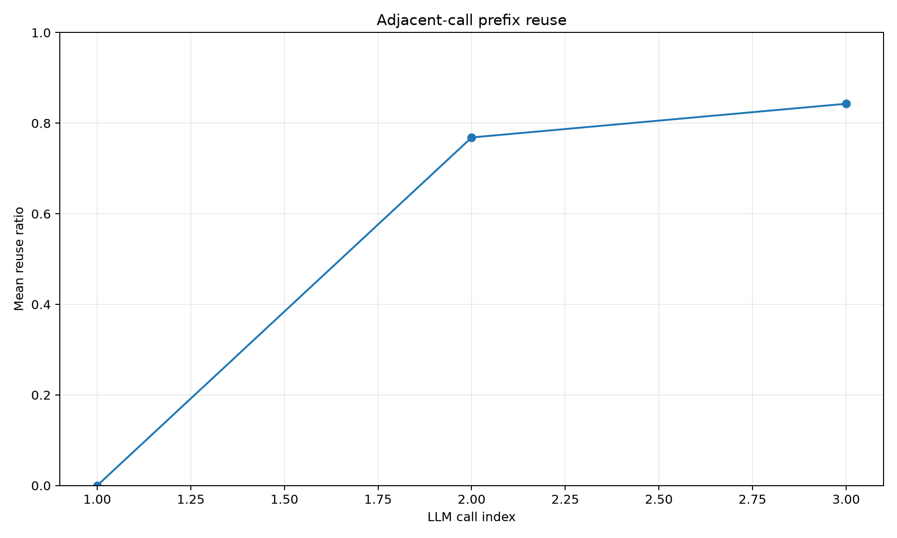
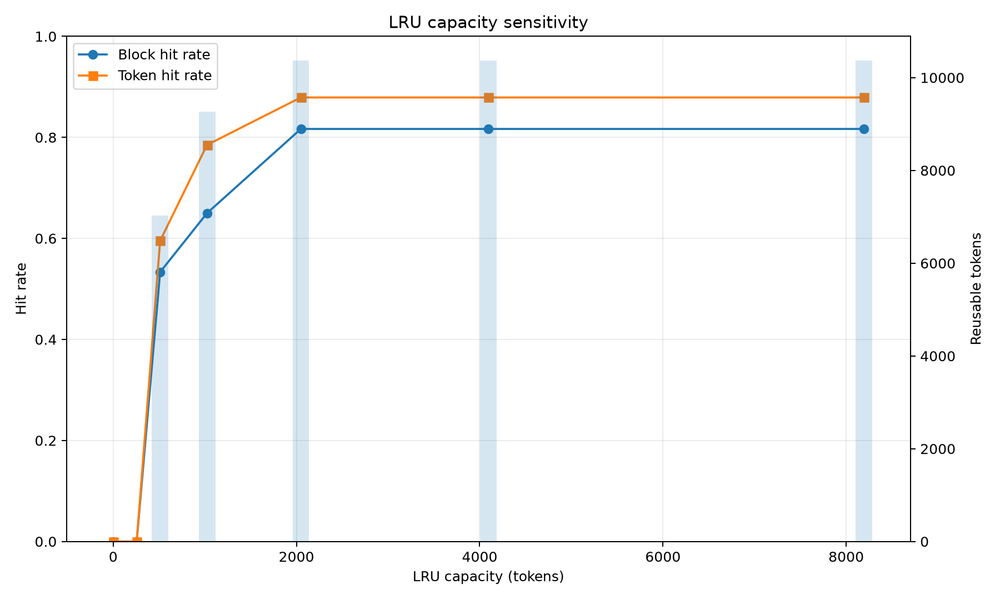

# 面向智能体的Prompt结构与KV Cache复用特征分析

科研轮转结题报告（2026 年 11 月）

## 摘要

本课题基于 Qwen-Agent 搭建多轮工具调用智能体，使用本地 Qwen3-4B 对 4 个长度换算与计算任务各运行 2 次，采集 24 条模型调用轨迹。分析内容包括 Prompt 组成、相邻调用的公共前缀和不同缓存容量下的复用情况。在同一次运行内，公共前缀占全部规范化输入 Token 的 59.85%。随后在 RTX 4050 Laptop GPU 上对相邻调用开展配对计时。复用前缀时，首 Token 延迟的中位数由 461.0 毫秒降至 91.9 毫秒。

## 1 研究背景

多轮工具调用中，智能体需要把工具返回结果与已有消息一同发送给模型。系统提示、工具说明和此前的消息可能在连续多次调用中保持一致。若两次输入从起始位置起具有相同的 Token 序列，推理服务可以复用对应的 KV Cache，减少输入阶段的重复计算。本课题分别通过轨迹统计、缓存模拟和本地推理计时，分析重复前缀的规模、缓存容量的影响以及首 Token 延迟的变化。

## 2 实验环境与轨迹采集

实验使用 Qwen-Agent 0.0.34、Qwen3-4B Q4_K_M 和 Ollama 0.40.4。智能体依次调用单位换算工具和计算器，再根据工具返回结果作答。以“每根材料长 2.5 米，求 4 根材料的总长度（厘米）”为例，第 1 次调用请求单位换算，工具返回 250 厘米。第 2 次调用依据换算结果请求计算总长度，工具返回 1000 厘米。第 3 次调用根据两次工具结果生成答案。

轨迹采集在 Qwen-Agent 的 `llm.chat` 接口进行，记录消息、工具说明、模型响应及调用顺序。工具请求和返回结果可在后续调用的消息中追踪。正式实验共完成 8 次任务运行，每次包含 3 次模型调用。[任务集](data/tasks.jsonl)与[原始轨迹](outputs/final_experiment_v2/traces)随仓库提供。

## 3 分析方法

**Prompt 分段与前缀比较。** 按用途将输入划分为系统提示、工具说明、对话历史、工具结果和当前问题五类。使用 Qwen-Agent 自带分词器统计规范化文本的 Token 数。相邻前缀比较保留消息顺序，从起始位置逐一匹配 Token，直至出现差异。每次调用的重复比例为公共前缀长度除以当前输入长度。批次理论复用比例以公共前缀长度之和除以全部输入 Token 数，每次运行的首轮公共前缀计为零。

**缓存容量模拟。** 将系统提示、工具说明和各条消息划分为逻辑块，按原始调用顺序回放全部轨迹。只有从请求起始位置连续命中的块才计入复用。空间不足时，按最近最少使用（LRU）策略淘汰缓存块。模拟允许缓存跨任务保留，Token 命中率以命中块的 Token 数除以访问块的 Token 总数。

**首 Token 延迟测量。** 从 8 次运行中提取 16 组相邻调用。每组以后一轮输入为测量对象，分别在禁用前缀复用和预先缓存前一轮输入的条件下计时。每组重复 4 次，共 64 对测量，两种执行顺序各占一半。推理使用 Ollama 随附的 llama-server 和 RTX 4050 Laptop GPU，保持模型已加载、单请求顺序处理。首 Token 延迟定义为客户端发出请求到收到第一个输出 Token 的时间。

## 4 实验结果与分析

### 4.1 Prompt 组成与前缀复用

24 次调用的系统提示与工具说明保持一致。随着工具请求和结果加入消息，平均输入长度由 375 Token 增至 579 Token。第 2、3 次调用平均分别有 76.84% 和 84.29% 的输入可与同次运行的上一轮匹配。合计 11,536 个规范化输入 Token，其中公共前缀共 6,904 个，理论复用比例为 59.85%。各类输入的 Token 数和复用间隔见[分段明细](outputs/final_experiment_v2/tables/prompt_call_metrics.csv)与[片段复用统计](outputs/final_experiment_v2/tables/segment_reuse_statistics.csv)。

### 4.2 缓存容量与模拟命中率

| 模拟缓存容量（Token） | 块命中率 | Token 命中率 |
| ---: | ---: | ---: |
| 0、256 | 0.00% | 0.00% |
| 512 | 53.33% | 59.53% |
| 1024 | 65.00% | 78.51% |
| 2048、4096、8192 | 81.67% | 87.90% |

系统提示和工具说明两块合计占 320 Token。在容量为 256 Token 时，缓存无法同时保留这两块，本批次的连续前缀未产生命中。容量升至 2048 Token 后，所测更高容量的命中率未再增加。该模拟可跨任务复用逻辑块，与同次任务内的相邻前缀统计采用不同的匹配范围和计数口径。

### 4.3 前缀复用对推理延迟的影响

| 指标（中位数） | 禁用前缀复用 | 启用前缀复用 |
| --- | ---: | ---: |
| 首 Token 延迟（毫秒） | 461.0 | 91.9 |
| 输入处理耗时（毫秒） | 443.0 | 78.6 |
| 实际处理的输入 Token 数 | 588 | 74 |

64 对测量中，启用复用时的首 Token 延迟均低于对应的对照组。逐对计算相对降幅后取中位数，得到 79.6%。首 Token 延迟与输入处理耗时同时降低，与服务端记录的重新处理 Token 数减少一致。[原始计时记录](outputs/final_experiment_v2/latency/pairs.jsonl)包含每对测量的执行顺序、输入长度、命中数量及耗时。

## 5 结论与局限

在本实验的工具调用流程中，固定的系统提示、工具说明和逐轮追加的历史消息形成了可复用的输入前缀。本地配对计时表明，在模型已加载且请求顺序执行的条件下，复用前缀缩短了首 Token 延迟。计时使用推理服务实际渲染的输入，轨迹统计使用 Qwen-Agent 层的规范化文本，两者的 Token 数可能不同。实验覆盖 4 个同类任务，计时范围截至首个输出 Token，完整任务耗时以及并发条件下的收益仍需另行验证。复现方法见 [README](README.md)。

## 参考资料

1. [Qwen-Agent 官方仓库](https://github.com/QwenLM/Qwen-Agent)
2. [Qwen3 Technical Report](https://arxiv.org/abs/2505.09388)
3. [SGLang: Efficient Execution of Structured Language Model Programs](https://arxiv.org/abs/2312.07104)
4. [llama-server 接口文档](https://github.com/ggml-org/llama.cpp/blob/master/tools/server/README.md)
